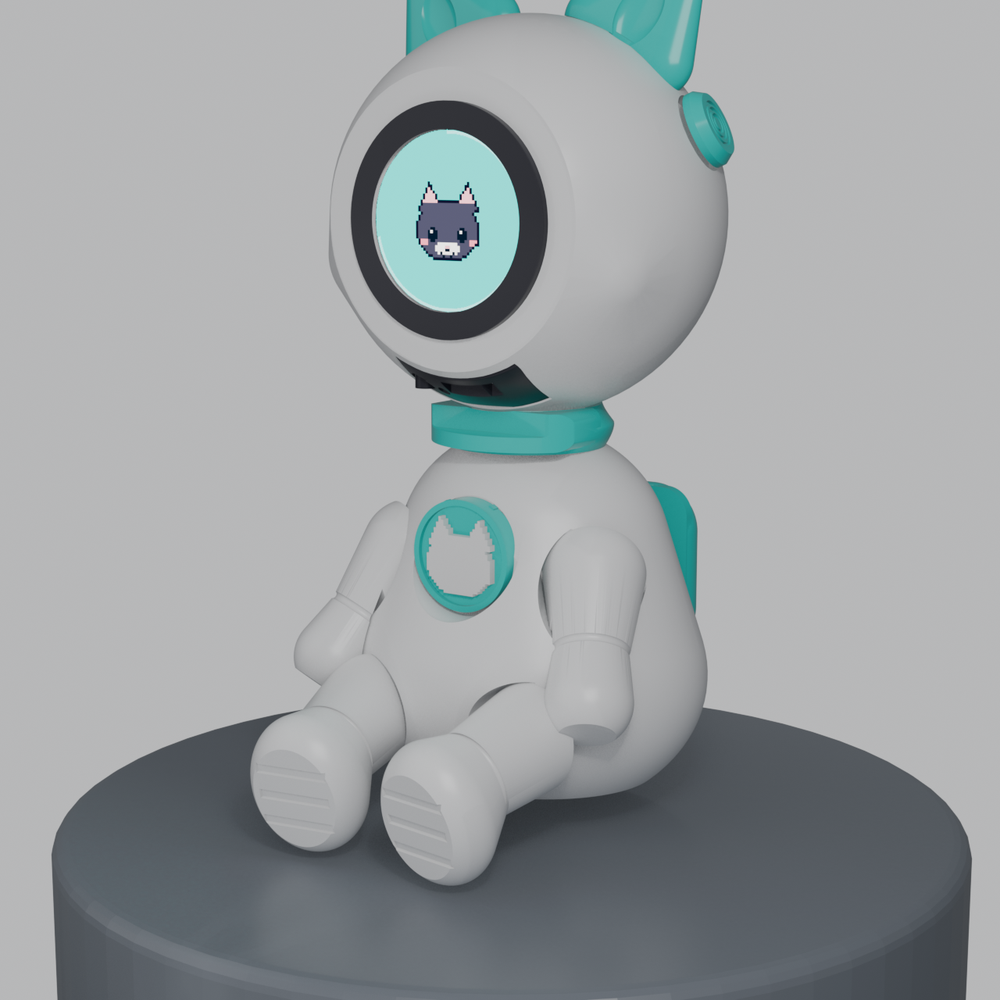
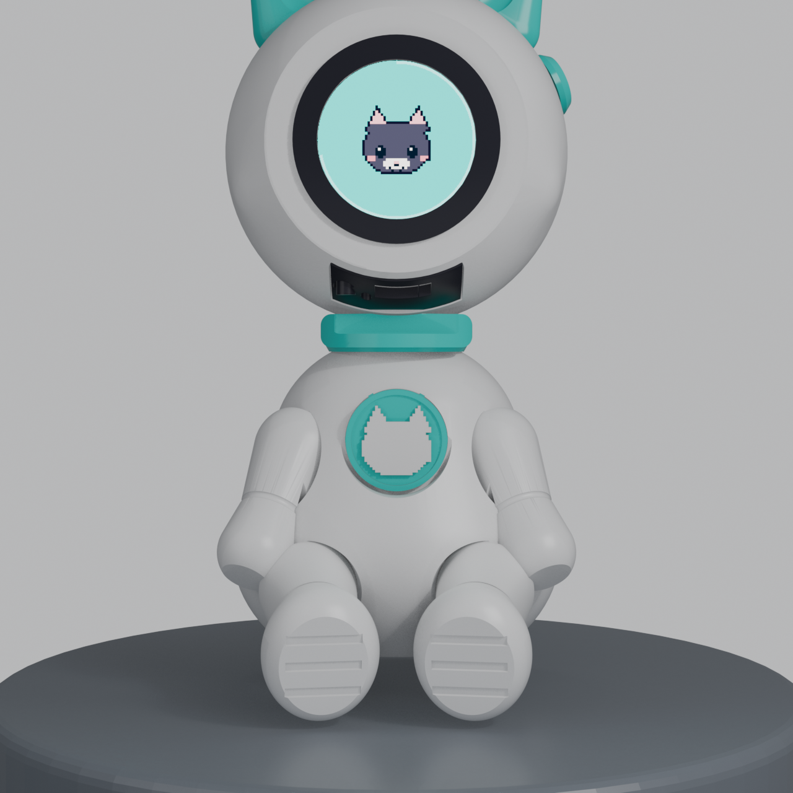
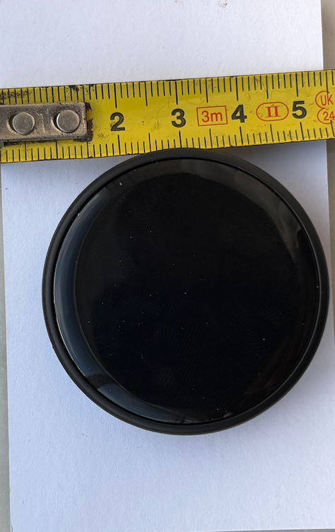
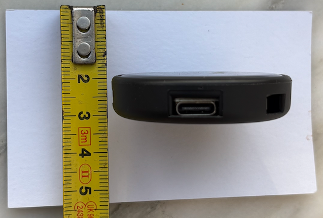
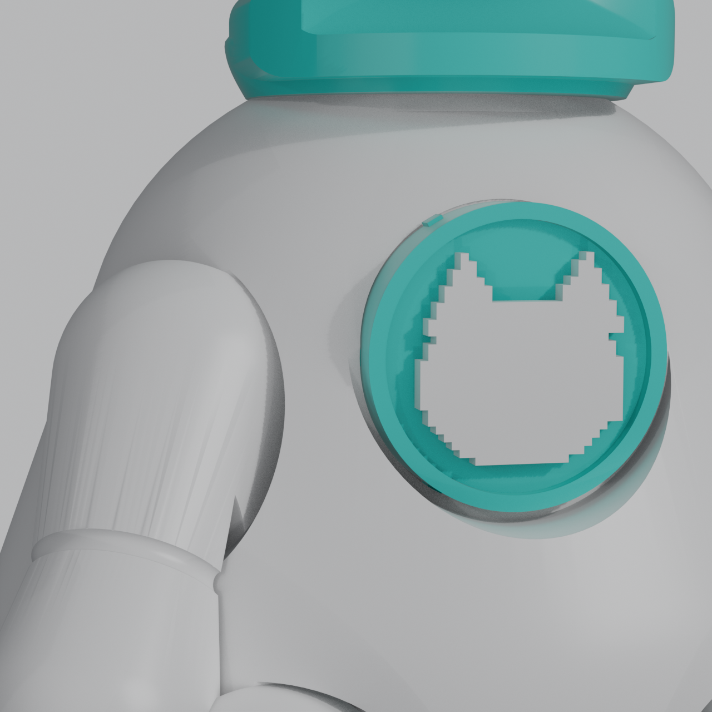
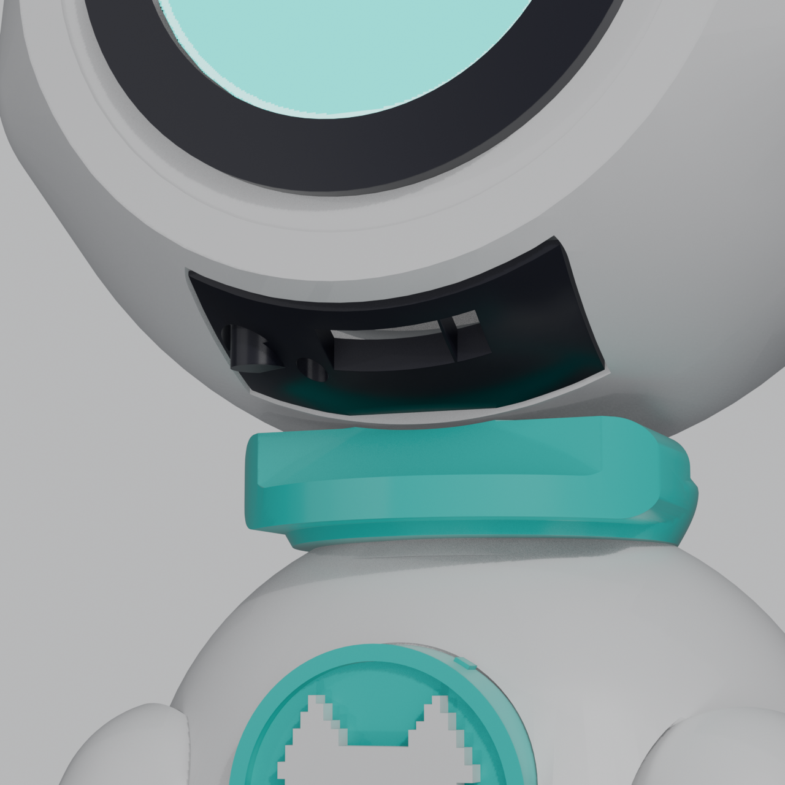

<div align="center">

# 🐈‍⬛ Proyecto Lúa · Juguete STEAM con Bloques y Realidad Aumentada

### Versión básica con placa V1 ampliada mediante sets complementarios tipo LEGO y Realidad Aumentada para Valeria+ y Descubre con Lúa


-00c4be?style=flat-square)


-8a8a8a?style=flat-square)


</div>

---

## 🧭 Visión General y Decisión de Producto (Octubre 2026)

**Lúa** es la mascota física interactiva de **[Valeria+](https://github.com/FrankBetances/Valeria)** y de **Descubre con Lúa**: una figura tangible con pantalla IPS circular de 240×240 px (32,4 mm de área activa a 27 fps) que espeja el refuerzo positivo, muestra los 120 pictogramas voxel del ejercicio, las 45 insignias y el progreso de nivel, porque **la niña o el niño mira a la mascota y manipula piezas físicas en lugar de tocar la pantalla de la tableta**.

Por decisión de dirección (**23/10/2026**):

1. **Se descarta definitivamente la versión robótica (`busto` motorizado de 4 DoF / 9 ejes tipo Reachy Mini):** Lúa no lleva motores, servos ni partes móviles motorizadas.
2. **Nos quedamos exclusivamente con la versión básica con la placa redonda V1 (`ESP32-2424S012C`), ampliada con sets complementarios tipo LEGO (`Lúa Construye`, paso Duplo de 31,80 mm):** la mascota física funciona como pieza central de un **juguete STEAM manipulativo de construcción por bloques y Realidad Aumentada (AR)**.
3. **Sets específicos e interoperables para dos plataformas:**
   - **Sets para Valeria+ (Terapia Auditivo-Verbal, Estimulación Sensorial y AR Clínica):** bloques con texturas hápticas, cilindros de prensión gradual, resonadores acústicos, canales para praxias de soplo y dinámicas de **Realidad Aumentada** (`ARCore + Google MediaPipe + Google Filament` nativo con mallas `.glb < 100 KB` y condicionamiento motor puro).
   - **Sets para Descubre con Lúa (Educación Infantil 0–6 años LOMLOE, STEAM y AR Educativa):** tableros y baldosas algorítmicas (*Lúa Camiños*), curvas, intersecciones, rampas de 15°/30°, guiado analógico de esferas y zócalo marcador de la gata, sincronizados con la app Flutter offline (`CustomPainter` vectorial, cero red, bilingüe gl/es, consignas **TPR en inglés** verificadas con SHA-256 y dinámicas espaciales de Realidad Aumentada).

<div align="center">
  
  
</div>

---

## 🧱 Arquitectura del Ecosistema: Muñeco Básico + Bloques tipo LEGO + Realidad Aumentada

```
               VERSIÓN BÁSICA LÚA CON PLACA V1 (ESP32-C3 · GC9A01 Ø32,4 mm)
        ┌───────────────────────────────────────────────────────────────────────┐
        │  • Figura física en PLA sin motores, sin tornillos ni pegamento       │
        │  • Carcasa de placa Ø50 × 13 mm sujeta con rosca dinámica M55 y X     │
        │  • Uniones por bayoneta/clic + encajes tipo LEGO en miembros y pecho  │
        │  • Pantalla 240×240 a 27 fps · Zero-Mic · Zero-PHI · BLE GATT         │
        └───────────────────────────────────┬───────────────────────────────────┘
                                            │
                       ESTÁNDAR MECÁNICO DUPLO (Paso 31,80 mm · EN 71-1 > 31,75 mm)
        ┌───────────────────────────────────┴───────────────────────────────────┐
        │     Piezas Núcleo (Core): Placas base 8×8, bloques 2×2 y 2×4,         │
        │      rampas continuas 15°/30°, ejes de giro y zócalo para Lúa         │
        └───────────────────────────────────┬───────────────────────────────────┘
                                            │
                ┌───────────────────────────┴───────────────────────────┐
                ▼                                                       ▼
  GAMA «VALERIA+»                                       GAMA «DESCUBRE CON LÚA»
  (Clínica / Hogar / Terapia + AR)                      (Escuela 0-6 años / LOMLOE / STEAM + AR)
┌─────────────────────────────────────────┐           ┌─────────────────────────────────────────┐
│ • Bloques hápticos/sensoriales          │           │ • Lúa Camiños: baldosas rectas y curvas │
│   (ondas, puntos, estrías ±1,5 mm)      │           │   de 12 mm para algoritmos tangibles    │
│ • Cilindros de prensión gradual         │ ◄───────► │ • Intersecciones, rampas 15°/30° y      │
│   y pesos calibrados de propiocepción   │   100%    │   guiado analógico de esferas           │
│ • Bloques resonadores acústicos         │  Inter-   │ • Zócalo marcador de la gata Lúa        │
│   y canales para praxias de soplo       │ operable  │   y fichas algorítmicas de giro         │
│ • Realidad Aumentada (ARCore +          │ (31,8 mm) │ • App Flutter offline (CustomPainter,   │
│   MediaPipe + Google Filament <100 KB): │           │   cero red, bilingüe gl/es + TPR SHA256)│
│   AR-1 orofacial, AR-2 localización,    │           │   y dinámicas espaciales de Realidad    │
│   AR-3 fijación visual (sensor ciego)   │           │   Aumentada guiadas por la docente      │
└─────────────────────────────────────────┘           └─────────────────────────────────────────┘
```

---

## 🧩 1. Los Sets Complementarios Tipo LEGO y Realidad Aumentada

Toda la familia de bloques complementarios se modela de forma 100 % procedural en **Blender (`Python bpy`)** con geometría 2-manifold cerrada, cumpliendo la directiva europea de seguridad en juguetes **EN 71-1** (todas las piezas superan el cilindro de partes pequeñas de **31,75 mm** para menores de 36 meses).

### Estándar Mecánico Común (Compatible LEGO Duplo)

| Parámetro Mecánico | Cota Nominal | Tolerancia y Función |
| :--- | :--- | :--- |
| **Paso modular (*stud pitch*)** | `31,80 mm` | Distancia entre centros de tetones contiguos en los ejes X e Y. |
| **Diámetro del tetón (*stud*)** | `9,40 mm` | Cilindro superior de inserción por fricción. |
| **Altura del tetón (*stud height*)** | `4,50 mm` | Altura efectiva del conector superior. |
| **Altura base del bloque** | `19,20 mm` | Altura estándar del cuerpo del bloque (sin contar el tetón). |
| **Tubo interior de retención** | `Øext 13,20 mm` | Cilindros huecos inferiores (*clutch power*) para bloques 2×2 y 2×4. |
| **Grosor de pared / robustez PLA** | `1,50 – 3,20 mm` | Rigidez estructural para impresión FDM en PLA/PETG. |
| **Offset radial de impresión 3D** | `Δ = 0,15 – 0,20 mm` | Compensación de contracción térmica para encaje suave y firme. |
| **Seguridad infantil (EN 71-1)** | `> 31,75 mm` | Cero piezas pequeñas desmontables con riesgo de ingesta o asfixia. |

### A. Sets Específicos para **Valeria+** (Rehabilitación, Sensorial y Realidad Aumentada)

| Pieza / Componente | Característica Física / Técnica | Aplicación Clínica y en el Hogar |
| :--- | :--- | :--- |
| **`val_textura_estriada` / `val_ondas` / `val_puntos`** | Bloques 2×2 y 2×4 con relieve superior háptico (±1,5 mm). | Estimulación táctil, desensibilización e integración propioceptiva palmar. |
| **`val_cilindro_presion`** | Cilindro de inserción con pestaña de resistencia calibrada. | Entrenamiento de fuerza de prensión bimanual, coordinación óculo-manual y pinza digital. |
| **`val_resonador_acustico`** | Bloque hueco con cavidad interna resonante amortiguada. | Discriminación acústica manipulativa (contraste entre percusión sorda y aguda). |
| **Canales de soplo y pesos calibrados** | Bloques acanalados para guiar flujo de aire y piezas lastradas. | Praxias respiratorias/orofaciales y regulación propioceptiva. |
| **Módulo de Realidad Aumentada (`ARCore + MediaPipe + Filament`)** | Renderizado nativo C++/JNI a 60 fps con mallas procedurales `.glb < 100 KB` y cámara como **sensor ciego** (100 % en RAM, Zero-PHI). | **AR-1 (Cinemática Orofacial):** avance proporcional al redondeo/apertura labial con control de simetría.<br>**AR-2 (Localización Instrumentada):** respuesta motora ante estímulo acústico con ~20 % de ensayos trampa.<br>**AR-3 (Selección por Fijación):** dianas en grados radiales de campo visual mediante mirada sostenida. |

### B. Sets Específicos para **Descubre con Lúa** (Educación Infantil 0–6 años LOMLOE, STEAM y AR)

| Pieza / Componente | Característica Física / Técnica | Aplicación Pedagógica en Aula (Asamblea) y Hogar |
| :--- | :--- | :--- |
| **`lua_camino_recta_2x2`** | Baldosa modular con ranura plana continua de 12 mm × 4 mm. | **Lúa Camiños:** secuenciación espacial, conteo de pasos y algoritmos tangibles en la alfombra. |
| **`lua_camino_curva_2x2` / `lua_interseccion`** | Arco cuadrante de radio 31,8 mm y cruce ortogonal de 4 vías. | Cambios de dirección (giros a izquierda/derecha), lateralidad y ramificación lógica. |
| **`lua_marcador_gata` + Figura Básica Lúa** | Zócalo con relieve de Lúa (2 mm) y acople del muñeco con placa V1. | Agente físico tangible que marca el origen, el destino y celebra en su pantalla cada reto superado. |
| **Rampas 15°/30° y guiado de esferas** | Planos inclinados modulares encajables sobre bloques base. | Física cotidiana analógica sin sensores electrónicos (*Observa – Experimenta – Construye*). |
| **App *Descubre con Lúa* + Realidad Aumentada** | Flutter 100 % offline (`CustomPainter` vectorial sin emojis, Zero-Network, Zero-PHI), datos en `sets_construccion.json` (gl/es). | La persona adulta guía la sesión; reproduce órdenes **TPR en inglés** (*"Step forward"*, *"Turn right"*) con hash SHA-256 verificado y proyecta los retos espaciales de construcción y Realidad Aumentada. |

---

## 🛠️ 2. La Versión Básica de Lúa con Placa Ampliada (Hardware y Carcasa)

### Electrónica: Placa Oficial V1 (`ESP32-2424S012C`)

- **SoC:** ESP32-C3 (`ESP32-C3-MINI-1U`) con conectividad **BLE GATT** (servidor NimBLE).
- **Pantalla:** Panel IPS circular **GC9A01 de 1,28"** (240×240 px, área activa **Ø32,4 mm**), validado en hardware real a **27 fps sostenidos** por franjas de 24 filas (`lua-firmware/docs/validacion_hardware_v1_esp32c3.md`).
- **Táctil capacitivo:** controlador **CST816** integrado en el cristal (`LUA_HAS_TOUCH 1`), gobernado por las políticas clínicas de turno (`PHASE(0)` / `PHASE(1)`) y de dinámica (`LUA_CAP_NO_TOUCH`).
- **Garantía estructural Zero-Mic y Zero-PHI:** la placa no tiene micrófono, el firmware bloquea por construcción cualquier captura de audio (`check-lua-mute.js`) y por el enlace BLE solo viajan índices numéricos a catálogos locales (jamás texto ni datos personales).
- **Dimensiones reales de la carcasa de la placa:** **Ø50 mm de diámetro × 13,0–13,5 mm de grosor** (con puerto USB-C y conector de batería `MX1.25` de 2 pines y paso 1,25 mm).

<div align="center">
  
  
</div>

### Diseño Mecánico del Muñeco Básico (100 % en Blender · Ajuste Dinámico Tipo LEGO)

- **Cero motores, cero tornillos y cero pegamento estructural:** todas las uniones emplean encajes tipo LEGO, roscas trapeciales robustas o bayonetas con tope y clic.
- **Sujeción dinámica de la placa (`anillo_placa` con refuerzo en X):** barril roscado M55 de 33 mm (8,3 vueltas) con cono centrador a 45°, arandela-muelle elástica y anillo trasero cerrado por dos brazos en **X** (5 × 4 mm) para girar con los dedos y evitar cualquier desplazamiento de la placa dejando cuatro pasos libres para el cable de batería.
- **Cuello con seguro, cabeza a rosca de ¼ de vuelta y accesorios con clic:** las orejas, el disco lateral, el aro del visor y el emblema/logo del pecho encajan mecánicamente sin caerse.
- **Carga USB-C accesible sin desmontar:** túnel inferior bajo la barbilla alineado con la muesca frontal del collar.

<div align="center">
  
  
</div>

---

## 🎨 3. Catálogo Visual en el Cristal y Emulador C++17 Sin Dependencias

El núcleo gráfico (`lua-firmware/core/`) está escrito en **C++17 puro** y corre idéntico en el ESP32-C3 y en el emulador web local (`http://localhost:8080`):

- **28 estados visuales en el catálogo principal:** 25 expresiones animadas de la gata (incluyendo las 8 emociones puras `AFFECT`, los estados de compañía `MOOD` —antojo, ronroneo, comiendo— y el descanso visual 20-20-20 `RELAX`) + visualización de pictograma (`PICTO`), insignia (`AWARD`) y anillo de nivel (`LEVEL`).
- **120 pictogramas en estilo voxel isométrico** (matrices de 24×24 con paleta de 33 colores sincronizadas con `ValeriaPixelArt.ts`).
- **45 insignias** (9 familias × 5 rangos: bronce, plata, oro, diamante y rubí) y **5 accesorios coleccionables del armario** (`ACCESSORY`).

<div align="center">
  
</div>

<div align="center">
  
  
</div>

### Comandos Rápidos del Firmware y los Gates

```bash
cd lua-firmware
make run                                    # Arranca el emulador interactivo en http://localhost:8080 (placa V1)
make test                                   # Ejecuta la suite de tests del núcleo C++17 (57 073 comprobaciones)
make shots && make shots-fichas             # Regenera las hojas de contacto de caras, fichas e insignias
cd esp32 && pio run -e lua-v1               # Compila el firmware oficial para la placa redonda ESP32-C3
```

---

## 📂 4. Estructura del Repositorio

| Ruta | Contenido |
| :--- | :--- |
| [`lua-firmware/`](lua-firmware/) | Submódulo con el núcleo C++17 (`core/`), el emulador POSIX (`sim/`), el transporte BLE/SPI (`esp32/`), los generadores en Blender (`tools/blender/muneco_v3.py`), los gates de verificación (`tools/check-*.js`) y toda la documentación técnica ([`lua-firmware/README.md`](lua-firmware/README.md)). |
| [`LUA_V3_IMPRIMIR_MASQUE3D/`](LUA_V3_IMPRIMIR_MASQUE3D/) | Paquete de producción V3 en Blender para taller (`masque3d`): 20 archivos STL por color con sostén propio, `SHA256SUMS.txt`, instrucciones para el laminador y manual de montaje paso a paso. |
| [`manual/`](manual/) · [`Manual_Ensamble_Lua_IKEA.pdf`](Manual_Ensamble_Lua_IKEA.pdf) | Manual visual de ensamblaje estilo IKEA y fotografías de comprobación métrica de la carcasa real (`Ø50 × 13 mm`). |
| [`renders/`](renders/) | Renders de estudio en Blender del muñeco básico, del emblema tipo LEGO en el pecho y de la ranura de carga USB-C. |
| [`stl/`](stl/) · [`INSTRUCCIONES_IMPRESION_Y_PLAN_LUA.md`](INSTRUCCIONES_IMPRESION_Y_PLAN_LUA.md) | Archivos STL de la maqueta previa y guía de laminación para Creality Ender-3 S1 Pro. |

> **Nota sobre archivos históricos:** Las carpetas y ficheros correspondientes a la **versión robótica descartada** (`busto` de 9 ejes, `stewart.cpp`, `kinematics.cpp`, `LUA-BUSTO-01`) y a las placas descartadas (`V2 ESP32-S3` y `e-Paper`) se conservan en el repositorio únicamente como registro histórico y para mantener la integridad de los gates de regresión (`CLAUDE.md` §9.0).
